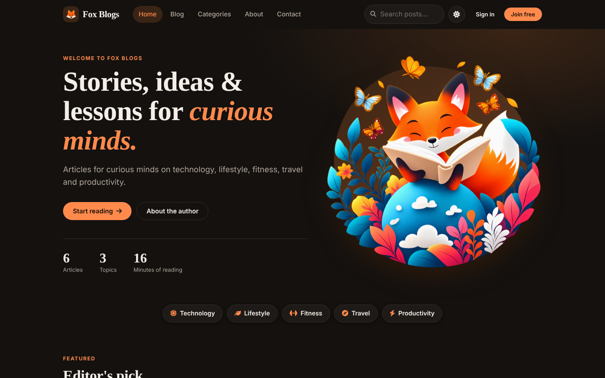
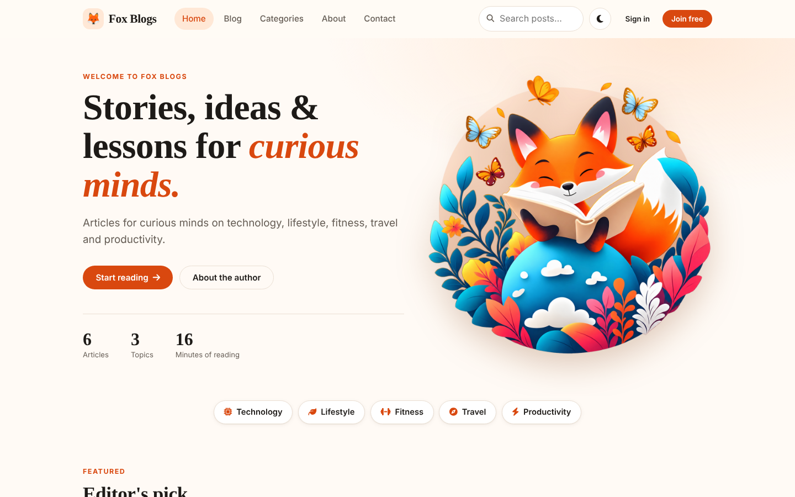
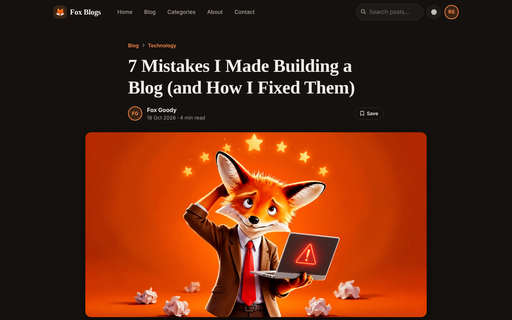
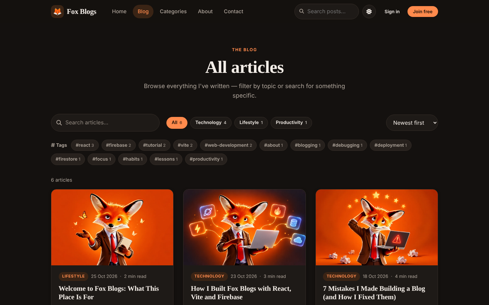
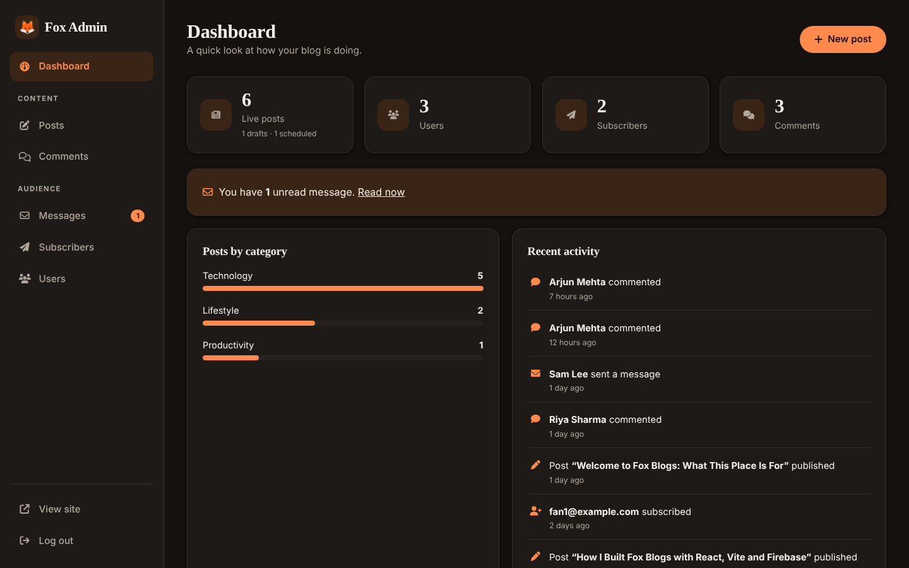
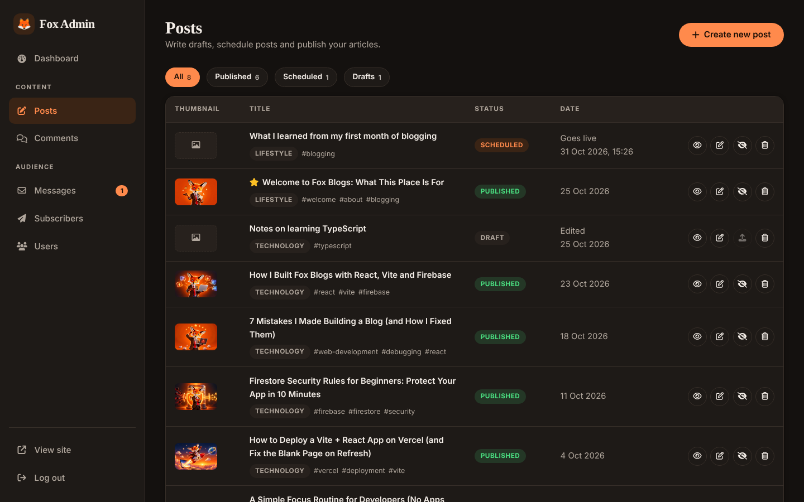
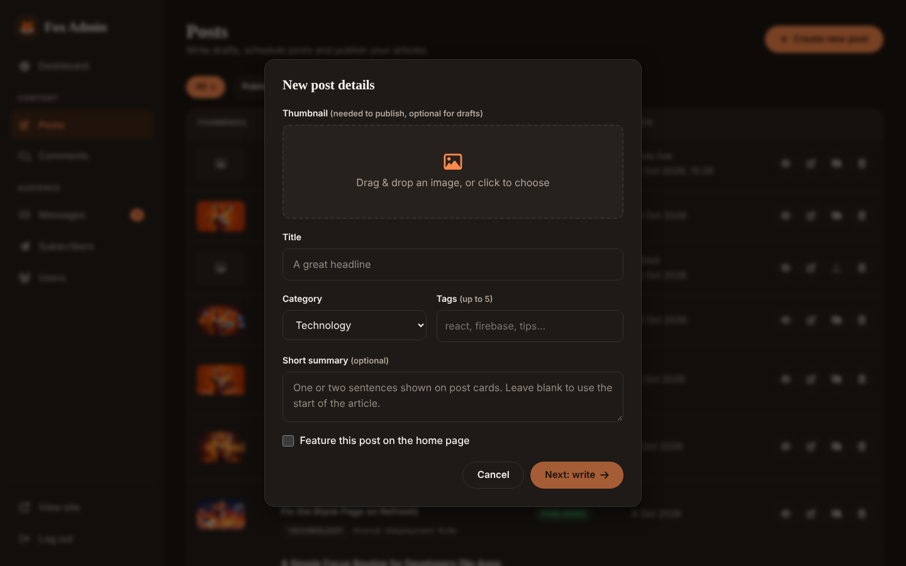

<div align="center">

# 🦊 Fox Blogs

**A full-stack blogging platform with a public reader site and a private admin dashboard.**

Draft, schedule and publish posts. Readers can sign in to like, comment, reply and save articles.

[](https://react.dev)
[](https://vite.dev)
[](https://firebase.google.com)
[](https://vercel.com)
[](./LICENSE)

**[Live demo](https://YOUR-SITE.vercel.app)** · **[Report a bug](https://github.com/official-naveen/fox_blogs/issues)**



</div>

---

## Table of contents

- [About](#about)
- [Screenshots](#screenshots)
- [Features](#features)
- [Tech stack](#tech-stack)
- [How it works](#how-it-works)
- [Getting started](#getting-started)
- [Environment variables](#environment-variables)
- [Firebase setup](#firebase-setup)
- [Scripts](#scripts)
- [Deployment](#deployment)
- [Security](#security)
- [Project structure](#project-structure)
- [Data model](#data-model)
- [Known limitations](#known-limitations)
- [Roadmap](#roadmap)
- [License](#license)

## About

Fox Blogs started as an older React and Firebase project that had a handful of pages and a basic admin form.
I rebuilt and extended it into a complete product: a polished reader experience, a proper admin area,
a post workflow with drafts and scheduling, and server-enforced security rules.

The goal was to practise the parts of a real app that tutorials skip: access control, content workflow,
loading and empty states, responsive design, accessibility, and deployment.

There is **no custom backend**. The React app talks to Firebase directly, and Firestore security rules decide
who can read or change each document.

## Screenshots

| Reader: light theme | Reader: post page |
| --- | --- |
|  |  |

| Blog index | Mobile |
| --- | --- |
|  |  |

| Admin: dashboard | Admin: posts with status filters |
| --- | --- |
|  |  |

| Admin: new post details |
| --- |
|  |

## Features

### Readers

- Home page with hero, featured post, topic shortcuts, latest posts, author intro and newsletter sign-up.
- `/blog` with live search, category and tag filters, sorting and *Load more*.
- Post pages with a reading-progress bar, reading time, syntax-highlighted code with a *Copy* button, share buttons
  (LinkedIn, X, Facebook, WhatsApp, copy link), an author box and related posts ranked by shared tags and category.
- **Likes, comments, threaded replies**, plus edit and delete for your own comments.
- **Tags** (up to 5 per post) with a clickable tag cloud and per-tag filtering.
- Accounts: sign up, sign in, password reset, profile (change name and password) and a private *Saved posts* list.
- Light and dark theme (saved in the browser and applied before first paint, so there is no flash).
- Responsive layout, skeleton loaders, accessible labels and focus states, 404 page.
- Contact form with FAQ, plus Privacy and Terms pages.

### Admin

- Role-protected dashboard with live stats, posts by category and recent activity.
- **Post workflow:** Draft, Scheduled and Published, with Publish and Unpublish in one click and status filters.
- Rich-text editor (TinyMCE) with live preview, cover image upload, category, tags, summary and a *Featured* flag.
- Inbox for contact messages, newsletter subscribers (search, copy, CSV export), comment moderation and user management.
- Works on phones and tablets.

## Tech stack

| Area | Tools |
| --- | --- |
| UI | React 18, React Router 7, plain CSS with design tokens |
| Build | Vite 6, ESLint 9 |
| Auth and database | Firebase Authentication, Cloud Firestore |
| Images | Cloudinary (unsigned upload preset) |
| Editor | TinyMCE (`@tinymce/tinymce-react`) |
| Code highlighting | Prism |
| Hosting | Vercel |

State is managed with React Context (auth, posts, users, loading and notifications). For an app of this size
that keeps the data flow easy to follow without adding a state library.

## How it works

```
 Browser (React + Vite)
   │
   ├── Firebase Auth ──────── who is signed in
   ├── Firestore ──────────── posts, comments, likes, messages, subscribers, users
   │      ▲
   │      └── Security rules decide who may read or write each document
   └── Cloudinary ─────────── images (uploaded from the admin editor)
```

- **Reading:** the public site queries only `published` and `scheduled` posts. A scheduled post is shown once its
  publish time has passed.
- **Writing a post:** the admin editor uploads images to Cloudinary first, then saves the post text and image URLs to Firestore.
- **Roles:** every user has a document in `users/{uid}` with `role: "user"` or `"admin"`. Route guards in the app
  send non-admins away from `/admin`, and Firestore rules enforce the same rule on the server.
- **Likes:** one document per person at `posts/{postId}/likes/{uid}`. The count is read with `getCountFromServer`.
- **Comments:** one flat `comments` collection. Replies carry a `parentId` and are one level deep.
- **Queries** use a single `where` plus client-side sorting, so no composite indexes are required.

## Getting started

**Requirements:** Node.js 18 or newer, and a free Firebase project.

```bash
git clone https://github.com/official-naveen/fox_blogs.git
cd fox_blogs
npm install
cp .env.example .env      # then fill in the values (see below)
npm run dev
```

Open <http://localhost:5173>. Restart the dev server whenever you change `.env`.

To personalise the site, edit [`src/config/site.js`](./src/config/site.js): your name, bio, contact email,
categories and social links.

## Environment variables

Copy `.env.example` to `.env` and fill in every value. Vite only exposes variables that start with `VITE_`.

| Variable | Where to find it |
| --- | --- |
| `VITE_FIREBASE_KEY` | Firebase console, Project settings, Your apps (`apiKey`) |
| `VITE_FIRE_BASE_AUTH_DOMAIN` | same (`authDomain`) |
| `VITE_PROJECT_ID` | same (`projectId`) |
| `VITE_STORAGE_BUCKET` | same (`storageBucket`) |
| `VITE_MESSASGING_SENDER_ID` | same (`messagingSenderId`). The spelling is kept from the original project |
| `VITE_APP_ID` | same (`appId`) |
| `VITE_MEASUREMENT_ID` | same (`measurementId`), optional, for Analytics |
| `VITE_CLOUDINARY_URL` | `https://api.cloudinary.com/v1_1/<cloud_name>/image/upload` |
| `VITE_UPLOAD_PRESET` | Cloudinary, Settings, Upload presets. Must be **unsigned** |
| `VITE_Editor_API` | Free API key from [tiny.cloud](https://www.tiny.cloud) |

> `.env` is git-ignored. Never commit real credentials. Firebase web config values are not secret by design,
> but your Firestore rules must be in place.

## Firebase setup

1. Create a project at the [Firebase console](https://console.firebase.google.com).
2. **Authentication → Sign-in method:** enable **Email/Password**.
3. **Firestore Database:** create a database (production mode).
4. **Firestore → Rules:** paste the contents of [`firestore.rules`](./firestore.rules) and click **Publish**.
5. **Project settings → Your apps → Web app:** copy the config values into `.env`.
6. **Authentication → Settings → Authorized domains:** add your deployed domain.
7. **Become the admin:** run the app and sign up. In Firestore open `users`, then the document with your user ID,
   and change `role` from `user` to `admin`. Sign in again and you will land on `/admin/dashboard`.
8. **Cloudinary:** create an unsigned upload preset (see the table above).
9. **TinyMCE:** add your site's domain to the key's approved domains.

If you are upgrading an older copy of the project, re-paste `firestore.rules`, then open **Admin → Posts** once.
Older posts that have no `status` are upgraded to *Published* automatically.

## Scripts

| Command | What it does |
| --- | --- |
| `npm run dev` | Start the dev server with hot reload |
| `npm run build` | Create a production build in `dist/` |
| `npm run preview` | Serve the production build locally |
| `npm run lint` | Run ESLint |

## Deployment

The app builds to static files, so any static host works. These steps are for **Vercel**:

1. Push the repository to GitHub.
2. In Vercel choose **Add New → Project** and import the repository. The Vite preset is detected automatically
   (build command `npm run build`, output directory `dist`).
3. Add every variable from `.env.example` under **Settings → Environment Variables**.
   Values are baked in at build time, so **redeploy after changing any of them**.
4. [`vercel.json`](./vercel.json) rewrites every path to `index.html`. Without it, refreshing `/blog` returns a 404.
   (`public/_redirects` does the same job on Netlify.)
5. Add the Vercel domain to **Firebase Authorized domains** and to the TinyMCE approved domains.

## Security

- **Rules, not buttons.** Hiding admin links is only convenience. [`firestore.rules`](./firestore.rules) enforces access on the server.
- Only admins can create, edit or delete posts. Drafts cannot be read by the public.
- Users can post comments only as themselves (text length is limited) and can edit or delete only their own.
- Users cannot promote themselves: `role` and `email` cannot be changed by the owner.
- Saved posts are private to their owner. Messages and subscribers are readable by admins only.
- The contact form and newsletter are write-only for the public, with size limits.
- `.env` is git-ignored and only `.env.example` is committed.

## Project structure

```
fox_blogs/
├── firestore.rules          # Security rules (paste into the Firebase console)
├── vercel.json              # SPA rewrite for Vercel
├── .env.example             # Variable names, no secrets
├── docs/                    # Screenshots and starter thumbnails
├── public/                  # Favicon and Netlify redirects
└── src/
    ├── App.jsx              # Routes and guards
    ├── config/site.js       # Name, bio, links, categories
    ├── firebase/            # Firebase initialisation
    ├── contexts/            # Auth, Post, User and Loading state
    ├── pages/               # Route-level pages (public and admin)
    ├── components/          # Reusable UI (cards, comments, likes, tag input, ...)
    ├── auth/                # Sign in, sign up and password reset
    ├── services/            # Small Firestore helpers (bookmarks)
    ├── hooks/               # usePageTitle, useTheme
    ├── utils/text.js        # Dates, excerpts, reading time, tags
    └── styles/theme.css     # Design tokens and shared styles
```

## Data model

| Collection | A document is | Main fields |
| --- | --- | --- |
| `posts` | A blog post | `title`, `content`, `thumbnail`, `category`, `tags`, `excerpt`, `featured`, `status`, `publishAt`, `createdAt`, `updatedAt` |
| `posts/{id}/likes` | One person's like | `uid`, `createdAt` (document ID is the user ID) |
| `comments` | A comment or reply | `postId`, `parentId`, `uid`, `name`, `text`, `createdAt`, `editedAt`, `deleted` |
| `users` | An account | `name`, `email`, `role` |
| `users/{uid}/bookmarks` | A saved post | `postId`, `createdAt` |
| `messages` | A contact message | `name`, `email`, `message`, `read`, `createdAt` |
| `subscribers` | A newsletter email | `email`, `createdAt` |

## Known limitations

I would rather list these than have you find them.

- **Scheduling runs in the browser.** There are no Cloud Functions, so a scheduled post is hidden by the app but could
  be read early by someone who queries Firestore directly. Use **Draft** for content that must stay private.
- **No server-side rendering.** Individual posts do not get their own social preview card when shared.
- **No automated tests in the repository yet.**
- **Comments are one level deep**, and the newsletter form only collects emails (export the CSV and use a mail tool).
- **Images are not resized by the app.** Use Cloudinary URL transformations or compress images before upload.
- The Privacy and Terms pages are starter text. Review them before relying on them.

## Roadmap

- [ ] Cloud Function to publish scheduled posts on the server
- [ ] Unit and end-to-end tests (Vitest and Playwright)
- [ ] Per-post social preview cards (pre-rendering)
- [ ] Image resizing through Cloudinary transformations
- [ ] Newsletter sending
- [ ] Reading history and post series

## License

Released under the [MIT License](./LICENSE).

---

<div align="center">

Built by **Fox Goody** · [GitHub](https://github.com/official-naveen) · [LinkedIn](https://linkedin.com/)

If this project helped you, a ⭐ on the repo is appreciated.

</div>
